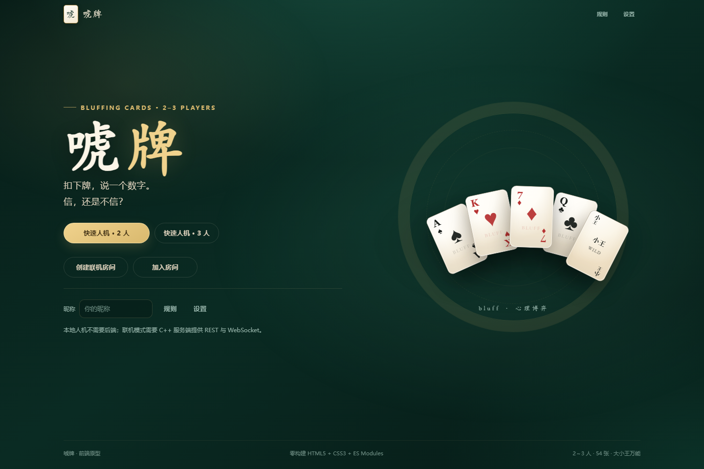

# 唬牌 · Bluffing Cards

一个零构建的「唬牌」（Bluff / Cheat / 吹牛）网页前端：HTML5 + CSS3 + 原生 ES Modules，包含本地人机对战、联机房间客户端、完整的规则/API/联调文档，以及一套可单独运行的演示机器人。

后端裁判、正式人机 AI 由课程项目其他成员实现；本仓库的前端可以在没有后端的情况下直接体验完整规则，也可以按 [`doc/api.md`](doc/api.md) 接入 C++ 服务端。



## 快速开始

要求：Node.js 20+（仅用于启动静态服务器和跑测试，没有 npm 依赖）。

```bash
node tools/serve.mjs
# 打开 http://localhost:8080
```

也可以使用任意静态服务器，但必须通过 HTTP(S) 访问，不能直接双击 `index.html`（ES Modules 在 `file://` 下会被浏览器拦截）。

- **快速人机 · 2 人 / 3 人**：完全在浏览器内运行本地规则引擎和演示机器人，不需要后端。
- **创建联机房间 / 加入房间**：调用 `/api/rooms` 与 WebSocket，需要先启动实现了 [`doc/api.md`](doc/api.md) 的后端。
- 地址带 `?room=ABC234` 时，首页会自动预填房间码。

## 已实现

- 2～3 人完整规则：54 张全发、宣称牌面与数量、大小王万能、揭牌只查最后一组、真假收牌、两次过牌与最终确认、待确认名次、2 人/3 人结束条件。
- 服务端权威的联机模型：前端只渲染 `GameView`，不计算揭牌真伪、胜负、名次。
- 本地 mock：纯规则引擎 + 三名性格不同的演示机器人（不是课程要求的正式 AI）。
- 牌桌、手牌多选、先手牌面选择、出牌确认、揭牌结果、历史记录、结算领奖台、规则弹窗、设置、音效、移动端布局。
- 服务端视图脱敏：只有自己的手牌可见；未揭牌的出牌内容不进入视图。
- 文档、协议示例、Node 单测、Chrome 截图。

## 目录

```text
static/                 前端（可直接部署）
  index.html            唯一页面
  css/                  设计令牌、基础、布局、组件、牌面、牌桌、结算、响应式
  js/
    main.js             应用装配与路由
    game/               牌组、mock 规则引擎、演示机器人、mock 客户端
    net/                REST / WebSocket / 协议信封 / 错误
    ui/                 各屏幕、弹窗、手牌、音效等
    config.js           同源默认配置与 window.__BLUFF_CONFIG__
    strings.js          中文文案与事件描述
tests/                  node:test 单测（无第三方依赖）
tools/serve.mjs         零依赖静态服务器
doc/                    规则、设计、API、联调、测试、示例、截图
```

## 联机后端

前端默认与后端同源：REST 为 `/api/*`，WebSocket 为 `/ws?room=&token=&v=1`。如果前后端分开部署，在 `static/index.html` 加载 `main.js` 之前设置：

```html
<script>
  window.__BLUFF_CONFIG__ = {
    apiBase: "http://127.0.0.1:9000",
    wsPath: "/ws"
  };
</script>
```

接口、字段、错误码、示例和联调顺序见：

- [`doc/api.md`](doc/api.md)：后端必须实现的 REST + WebSocket 契约。
- [`doc/联调指南.md`](doc/联调指南.md)：从零联通前端的步骤与排查清单。
- [`doc/游戏规则.md`](doc/游戏规则.md)：规则基线（也是后端裁判的验收依据）。
- [`doc/前端设计.md`](doc/前端设计.md)：前端架构、交互和已知限制。
- [`doc/程序设计.md`](doc/程序设计.md)：课程项目程序设计说明。
- [`doc/测试说明.md`](doc/测试说明.md)：测试方法、用例和验收记录。

## 测试

`node --test` 的测试运行器在部分受限 Windows 沙箱里会因 `spawn EPERM` 失败，因此推荐直接运行测试文件：

```bash
node tests/cards.test.js
node tests/engine.test.js
node tests/bots.test.js
node tests/protocol.test.js
node tests/net-client.test.js
node tests/examples.test.js
```

也可以使用：

```bash
npm test
```

（`package.json` 的 `test` 脚本按上述文件顺序串行执行。）

## 范围与限制

- 正式 C++ 后端、正式人机 AI、语音、滑动拖选、断线重连 UI、4 人以上、旁观、聊天、账号、排行榜、部署均不在本次前端范围内。
- 联机协议预留了 `playerToken`、`sync` 和 `playerId`，但当前 UI 不自动重连；刷新页面会回到首页。
- 本地 mock 只是演示和前端规则测试用的参考实现，不参与课程 AI 评分。
- 两份基线 DOCX 与 `doc/开题报告.*` 保持原样，未改动。

## 许可

MIT，见 [`LICENSE`](LICENSE)。
